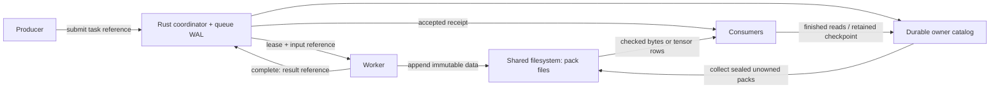

# Design and protocol specification

[中文版](DESIGN_zh.md)

This is straw's design and spec entry point. Humans review the rules and
premises; agents compare document → TLA+ → actual implementation. Stable rule
IDs connect the three flows below. See [format](FORMAT.md) for bytes and
[usage](USAGE.md) for APIs and application integration.

## Architecture and tradeoffs

AI pipelines share tokens, scores, routing decisions, tensors and intermediate
state. straw separates three questions: immutable packs store bytes; a queue
WAL records tasks and acceptance; a shared catalog records who still needs data.



The coordinator handles metadata while workers write payloads directly to the
mounted filesystem. Stable receipts replay the original result after a lost
reply; task execution and application side effects may still repeat. Applications
own worker placement, RPC, model execution and sample meaning.

References identify immutable extents by path, offset and length; manifests are
records inside the packs. Chunk checksums support row reads. COW publishes a new
version of each changed tensor and reuses unchanged references; there is no
page-level COW, live-record relocation or pack compaction.

Rust owns framing, validation, fsync, WAL, state transitions and ownership.
Python provides typed APIs, NumPy/PyTorch conversion and orchestration. Core
calls release the GIL but copy input buffers into Rust memory; writes are not
promised zero-copy. Python maintains no second WAL/queue state machine; tests
retain independent models and wire-format oracles.

straw targets bounded jobs with explicit retention. Full WAL/task history stays
in memory after replay; GC does not bound journal growth or guess abandoned
writers are dead. Small synchronous transactions may be fsync-limited;
[measure](BENCHMARKS.md) throughput with the actual workload.

<a id="environment"></a>

## Terms, environment and caller obligations

Common terms: **accepted** means the queue WAL contains a synchronized complete
transaction; **applied** means its in-memory business state is rebuilt/updated;
**protected** means a durable owner retains the full transitive pack closure;
**reclaimed** means unlink and every required directory barrier precede a durable
receipt. A returned error does not imply that no effect occurred.

These premises do not follow from successful tests. Finite model bounds,
algorithm retry budgets and measured percentiles have different meanings.

| External condition | What straw itself must do |
|---|---|
| Successful file sync persists preceding bytes; directory sync persists relevant name changes. Errors may follow effects. | Issue every required barrier on the correct descriptor/path; preserve uncertainty after error. Do not infer durable absence from advisory stat or an earlier failed sync. |
| All catalog peers use one stable lock inode; namespace bindings remain stable. | Acquire the lock, reopen fresh, compare device/inode and pool/run, recover, and hold the lock through recheck/mark/append. Bind caches to exact context. Replacement detection at entry cannot prevent an adversary replacing a live locked inode. |
| Exactly one externally fenced coordinator mutates each queue. | Preserve request content/receipt identity; check attempt and epoch for new admissions. An owner string is an assertion, not fencing. Numeric clock drift and election/partition recovery are outside the models. |
| Immutable data and references, truthful reads and collision-resistant hashes/library behavior. | Read/authenticate all requested spans, check framing/lengths/envelope/index, enumerate the complete dependency graph and verify cache keys. A successful lower primitive is not evidence that its caller selected the right bytes. |
| Writer gate handoff completes or cancels old remote in-flight I/O; fences are durable and visible to later holders. | Hold/check the exact gate, register operations, preserve pending descriptions, authenticate recovered results, stage/reconcile/release/settle/seal/receipt in order. A process dying or a timeout is not sufficient. |
| Applications truthfully report completed readers/ranks, choose committed matching checkpoints and eventually release owners when progress is requested. | Preserve readers across revocation, retain replay inputs before acknowledgements and reactivate rewind roots before the queue WAL. Filesystem progress cannot imply application release. |
| For liveness only: returning I/O/locks, eventual fault stabilization, fair scheduling and continued caller retries. For reads: the configured visibility premise. | Keep retries enabled, distinguish invalid/permanent failures, preserve pending work and finite read budgets. No automatic GC daemon, per-task fairness or wall-clock SLA follows. |
| Payload providers eventually return; compiler, allocator, serde, SHA and OS obey their contracts. | Enforce advertised lengths, checked arithmetic and callback errors. Ordinary deterministic helpers use real regression tests, not library proof wrappers. |

The machine-readable [environment_contracts.json](../verification/environment_contracts.json)
indexes these premises and consumers: `provided_by` names the provider,
`implementation_obligation` is work straw must perform, and `unproved` records
the evidence boundary. Inventory checks validate IDs, files and imports, not
the truth of assumptions. Qualify the actual mount and failure model using the
[deployment guide](FILESYSTEM.md).

<a id="distributed"></a>

## 1. Distributed protocol: commit, retry and recovery

<a id="c1"></a>

**C1 — Handoff.** Publish immutable data with staging protection. To accept it:

```
retain complete destination roots in catalog; sync catalog
write queue frame (header, payload, trailer); sync queue WAL
arm application quarantine; apply all events; confirm successful application
consume staging with the unique durable handoff receipt
reply
```

Catalog and queue logs are independent. Any crash between these steps can leave
extra protection. It must never leave an accepted live reference unprotected.
The accepting frame includes the handoff identity. Recovery reconstructs pending
handoffs before newer commits, cached replies or GC; a recorded old handoff cannot
consume a subsequently restaged publication. Retirement of replay history is
itself a durable queue transaction before owner pruning.

<a id="c2"></a>

**C2 — Identity and retry.** A stable request ID binds content and result. Look up
a recorded matching receipt before revalidating its old payload or lease; the
payload may already have been collected. Conflicting content is an error. A new
request must pass current task/attempt/epoch and expiry checks. Recovery revokes
old work authority but preserves outstanding reader roots. External fencing must
exclude concurrent coordinators; an `exclusive_owner` string is not enforcement.

<a id="c4"></a>

**C4 — Checkpoint rewind.** Persist the model/optimizer/RNG checkpoint together
with its matching consumer position. Results processed after that checkpoint need
independent replay ownership before acknowledgement. Restore that checkpoint's
position, not the latest queue cursor. Before a rewind WAL update, reactivate the
newly needed receipt/batch roots; missing protection or corrupt data rejects the
update. Release old checkpoint/replay owners only after replacement is durable.
The application supplies the actual checkpoint commit and rank-completion signals.

<details>
<summary>Model and implementation correspondence</summary>

| Rule | TLA+ actions / properties | Deliberate abstraction |
|---|---|---|
| C1 | `DurableHandoff`: QueueRetain, CatalogWrite/Sync/Reply, QueueWrite/Sync/Reply, Consume, Prune; AcceptedProtected, StageReleaseOrdered. `CrossLogComposition`: Accept/Consume/Restore; QueueCoverage, OldHandoffNoEffect | DurableHandoff separates partial writes and both syncs. Composition uses durable complete transactions; it must not be used as evidence that lower write/sync/apply are atomic. |
| C2 | `Completion`: OnlyCurrentAdmission, ReplayAfterRecovery, NoConflictingReplay. `RequestReplay`: OneAcceptance, CachedReply. `CrossLogComposition`: CurrentLeaseOnly, CorrectRetry | Small identity domains, Boolean expiry; no numeric clock or election model. Receipt replay remains valid after epoch/attempt change. |
| C4 | `TrainingResume`: HoldReplay/Acknowledge/Checkpoint/Restore; CheckpointMatches, ReplayDataAvailable, ResumeMatchesModel. `CrossLogComposition`: Retain/Restore, QueueCoverage | Scalar training positions stand for sparse/batched progress. Actual checkpoint-file publication and optimizer correctness belong to the application. |

| Rules | Actual caller chain | Regression / counterexample entry |
|---|---|---|
| C1–C2 | `rust/coordinator.rs`: open/commit/finish_consumption/retain_commit → `queue_commit::persist_and_apply`, `queue_handoff`, `request`, completion admission in coordinator | `tests/test_durable_handoff.py`, `test_commit_consumption.py`, `test_request_replay.py`, `test_filesystem_queue.py`; TLC queue-before-retain, early sync/reply, duplicate acceptance, stale epoch/attempt, consume-restage controls |
| C4 | `Coordinator::training_roots/commit`, `queue_commit::restore_event`, `queue_progress`, `queue_roots`, `Config::verify_queue_reactivation` | `tests/test_consumer_rewind.py`, `test_resume_workflow.py`, `test_filesystem_queue.py` optimizer replay; TLC mixed checkpoint, latest cursor, missing replay owner, restore-without-retain controls |

</details>

<a id="wal"></a>

## 2. WAL and data I/O

These are the log recovery, immutable publication and authenticated read rules
used by the upper protocol.

<a id="c3"></a>

**C3 — WAL context and recovery.** Appends require a usable exclusive journal.
Catalog transactions acquire a stable lock, open fresh, verify the same inode and
pool/run, recover and synchronize, then call business logic. Entry and exit guards
reject dirty, nested or foreign contexts. Before fallible writes or callbacks,
arm quarantine. An error or caught unwind leaves it armed; successful lower fsync
alone cannot clear a partial application or authorize cached operations.

Recovery authenticates framing and exact hash spans, replays complete transactions
in order, rejects complete corrupt frames, truncates only incomplete tails, syncs
and seeks to the valid end. Rebuild business indexes, receipts and derived caches
from that same prefix before reuse. Never lose an acknowledged prefix. A complete
uncertain frame may survive; its retry must not produce a second acceptance.

<a id="r1"></a>

**R1 — Preparation and durability.** Use a fresh non-reused pack name. Register it
open before data I/O, and retain dependency preparation owners before writing a
manifest. Capture the old append boundary before writing; incomplete cleanup must
never truncate an acknowledged prefix. Keep unresolved setup/cleanup state across
errors. Synchronize data and required directory names, persist staging protection,
then release preparation holds. Seal only after pending cleanup is resolved.

<a id="r2"></a>

**R2 — Publication retry.** Bind unresolved output to the exact API, request and
contents. Save the description before uncertain sync. Reject conflicting work;
a correct retry repeats unknown barriers and authenticates the original bytes
before returning. Do not lose a completed-but-unreturned description during close
or rotation. Staging is transferred only to the exact completed handoff, and may
start a new lifetime after an old handoff has completed.

<a id="r3"></a>

**R3 — Authenticated reads.** The caller needs G1 protection. Bind the reference
to its pool/run and namespace. An index-cache hit requires the exact immutable
reference. Check extent bounds and selected frame/index agreement, authenticate
the envelope and requested payload/checksum chunks, and bind tensor dtype/shape/
length before returning or allocating payload. A cached index never skips
record/envelope/payload validation. Empty typed ranges still validate layout.

<a id="r4"></a>

**R4 — Visibility and failure.** File length, header, footer/index, envelope and
payload can become visible independently. Retry recognized visibility failures
within the shared finite budget; close the failed descriptor and open fresh each
time. Name `NotFound` has its own finite lookup budget; unrelated I/O errors stop.
Persistent corruption exhausts/rejects, never returns unauthenticated bytes.
Eventual visibility is an explicit deployment premise, not a measured p99 and
not a guarantee that every input succeeds. Hash, parser, allocator and filesystem
implementations remain external to finite protocol model checking.

<details>
<summary>Model and implementation correspondence</summary>

| Rule | TLA+ actions / properties | Deliberate abstraction |
|---|---|---|
| C3 | `WalRecovery`: Write/Fail/Scan/Truncate/RecoverSync, AcknowledgedSurvives, ReadyDurable. `CatalogTransaction`: BoundCaller, CacheMatchesPrefix, NoCachedAfterError. `CommitApplication`: Begin/Hook/Recover, AcceptedDataPresent | Frame parts abstract bytes; hashes/parser and lock service are external. Actual callbacks and all public guards need implementation review. |
| R1 | `PublicationPreparation`, `IncompletePublication`, `DirectoryDurability`, `ProvisionalHold`, `PublicationFinalization`: reservation, rollback, directory barriers, staging, sealing | Unique immutable names and truthful filesystem barriers; a live writer owns rollback authority. |
| R2 | `PendingPublication`: OneCompletedFile, WriterFenced, DurableVerifiedReturn. `PublicationHandoff`: NoForgottenUnreturnedFile, CompletedHandoff. `StagingConsumption`: receipt/graph recovery | Failed responses can leave effects. Different API/request/content must not consume or overwrite unresolved output. |
| R3 | `ReadAttempt`: Index/Frame/Envelope/Payload, NoUnverifiedReturn. `RangeRead`/`TypedRead`: authenticated ranges and layout. `NamespaceIdentity`: canonical bindings | Distinct wire/index/frame/envelope faults remain distinguishable. Warm caches authorize only an exact previously authenticated index, not record bytes. |
| R4 | `ReadAttempt`: CloseFailed/Retry, ReleasedBetweenAttempts, Terminates. `ReadLookup`: lookup vs extent retries, HardErrorsStop | VisibleBy counts attempts, not milliseconds. Persistent corruption and unrelated storage failures need negative outcomes; valid visible inputs need positive outcomes. |

| Rules | Actual caller chain | Regression / counterexample entry |
|---|---|---|
| C3 | `journal_owner::{open,append_with,recover_with}` → `journal_io` → `journal_state`, `wal_append`, `wal_recovery`, `wal_source/sink`, `file_adapter`, `file_primitives`; `catalog_runtime::Transaction` → `catalog_transaction::execute`, `catalog_log`; `queue_application::{arm,apply,confirm,restore,permitted}` | `tests/test_wal_recovery.py`, `test_task_recovery.py`; native `gc` replacement-inode, nested-entry, caught-unwind, dirty-cache tests; `queue_application` callback/partial-body tests; byte-prefix/XOR and process-exit crash campaign |
| R1–R2 | `Store::finish/publish_attempt/close`, `Config::finalize_publication` → `incomplete`, `pending`, `finalization`, `holding`; `gc::consume_once` → `staging_consumption` | `tests/test_publication_preparation.py`, `test_pending_publication.py`, `test_provisional_holds.py`, `test_commit_consumption.py`, `test_packed_store.py`; native streamed callback tests |
| R3–R4 | `Reader` and read session in `rust/store.rs` → `record_index::Cache/Attempt`, `reference_node`, `extent_retry::run`, `bounds::frame_position/authenticated_span`, native read/hash operations | `tests/test_extent_visibility.py`, `test_read_session.py`, `test_extent_bounds.py`, `test_tensor_preflight.py`, `test_tensor_granularity.py`; TLC cold/warm cache, independent visibility, wrong index/frame/envelope/cache, payload corruption and stalled retry controls |

</details>

<a id="gc"></a>

## 3. Ownership and GC

<a id="g1"></a>

**G1 — Roots.** Protect the complete graph of each live task, outstanding reader,
unprocessed result, unfinished batch, checkpoint, staging and preparation owner,
and every other queue. Lease timeout/cancel/epoch revocation does not imply that
reading ended. Only explicit completion or externally established worker retirement
releases those reader roots. Serialized reference bytes alone are not ownership.

<a id="g2"></a>

**G2 — Reactivation and caches.** Cache only complete immutable closures within
the same pool/run/namespace and reference identity. Snapshot candidates under the
catalog lock, authenticate missing roots outside it, then reacquire a fresh locked
catalog and recheck all source owners and tombstones before appending any new
owner. Authentication is not a retained snapshot. Reuse an existing owner only if
it covers the requested root: reserved queue names bind the reference digest;
mutable public owner names require checking their retained closure. The lower
compatibility API can perform authentication while already holding the lock.

<a id="g3"></a>

**G3 — Reclamation.** After C1's durable history retirement, prune only the current
queue's obsolete owners. Under the catalog lock:

```
discover sealed packs not reachable from any owner
append permanent tombstones; sync catalog
unlink every pending target (including those advisory stat calls missing)
sync every affected parent; repair/sync missing ancestor names if needed
append reclamation receipts; sync catalog
```

Unlink `NotFound` is idempotent absence, not durable deletion. Even an absent
pending file needs its parent barrier. Other errors propagate and keep pending
work. A receipt stops repeated deletion/accounting but retains the permanent
tombstone; late retain cannot revive that path. Live extents protect whole packs.
Offline cleanup requires stopped clients, no shared catalog/queue markers, a
complete accepted-root/path-binding trace and a fresh unchanged inspection.

<a id="g4"></a>

**G4 — Writer retirement and progress.** Every writer mutation holds its exact
incarnation gate and checks the durable fence. Register operation identity,
preparation owner and dependencies before issuing their effects. Retirement takes
the same gate, persists a fence, drains old I/O, reconciles registered operations,
then releases preparation owners, records settlement, seals reservations and
persists the retirement receipt. Recover authenticates complete results and stages
them before release; abandon makes no readable-result claim. A retry may repeat
any already-effective step. PID, age and timeout never establish safe retirement.

Safety holds while owners remain and errors recur. Eventual reclamation concerns
sealed **permanently unowned** objects and additionally requires continued GC calls,
returning lock/I/O operations, eventual stabilization and fair scheduling. No
latency bound or automatic background collector follows from this rule.

<details>
<summary>Model and implementation correspondence</summary>

| Rule | TLA+ actions / properties | Deliberate abstraction |
|---|---|---|
| G1 | `Ownership`: ReaderProtection, CheckpointProtection, NoDanglingReferences. `DurableHandoff`: ReadersProtected; independent reader/checkpoint/peer cases | Complete application roots must be supplied by straw callers; reference possession is not a root. Permanent-owner cases check safety without assuming release. |
| G2 | `ReactivationRace`: Prepare/Verify/Recheck/Append; AuthenticatedRoot, CompleteAuthorizedClosure, NoDanglingRestore. `DependencyTraversal`: CompleteClosure | A complete authenticated graph is the lower read boundary. Cache context mismatches cause fresh authentication; owner/root mismatch rejects before any owner append. |
| G3 | `GCDiscovery`, `GCBatchDeletion`, `GCParentRepair`, `GCReceipt`: discovery, mark, unlink, shared-parent/ancestor barriers, receipt; DurableCompletion, ReceiptIsSafe, ReceiptKeepsFence | Multi-parent and missing-parent obligations remain separate; stat is advisory. `OfflineRoots`/`OfflineAliases` add stopped-client and binding roots, not permission for concurrent cleanup. |
| G4 | `WriterRetirement`: register/hold/submit/finish, fence/drain/authenticate/recover/release/settle/seal/receipt; AuthenticatedRecovery, ReceiptSound, RequiredProgress. `WriterLifetime`: in-flight work. `DurableHandoff`: EventuallyReclaimed | Gate handoff must finish/cancel old remote I/O. Release and registry settlement are distinct crash steps. Liveness needs stabilization, scheduling and actual caller retries. |

| Rules | Actual caller chain | Regression / counterexample entry |
|---|---|---|
| G1–G2 | `queue_roots::collect`, `queue_reader`, `queue_gc::prepare/require`; `gc::VerifiedReactivation::verify`, `check_reactivation_owners`, `retain_verified_inner`, `closure_inner` → `closure::collect`, `reference_node`, `record_index` | `tests/test_online_gc.py`, `test_queue_gc_roots.py`, `test_path_identity.py`; `tests/native.rs` reactivation pool/run, missing-source and owner-replacement races; TLC stale snapshot, wrong context/root and missing dependency controls |
| G3 | `Coordinator` collection → `queue_retirement`, `queue_gc_prepare`, `gc_collection::Batch::run` → `gc_mark`, `gc_batch`, `gc_io`, `directory_io`, `gc_receipt` | `tests/test_gc_batch.py`, `test_gc_receipts.py`, `test_gc_missing_parent.py`, `test_offline_aliases.py`; native absent-file/failed-barrier and shared-parent tests; TLC early receipt, lost tombstone, missing parent controls |
| G4 | `Store` mutation → `writer_gate_flow`, `writer_gate::Registry`; `Config::retire_writer` → `writer_retirement::execute`, `gc_writer::Retirement/Recovery`, `writer_registry::reconcile_registered`, `writer_ownership::authenticate_all` | `tests/test_writer_retirement.py`; native `gc_writer` corruption, recover/abandon and registered-owner tests; TLC death-unlock, skip registry/authentication, early release/receipt and conditional progress |

</details>

<a id="review"></a>

## Reviewing the spec against implementation

The tables state abstraction differences; they are not refinement proofs.
Models live in `verification/<area>/tla/`, Rust in `rust/`. Check the actual
`.cfg` and runner configuration to confirm that a property is enabled. Humans
review the rules above; agents use the
[straw-protocol-review skill](../.agents/skills/straw-protocol-review/SKILL.md)
to compare document to TLA+, then trace TLA+ to actual public callers.

Retained models target persistence, cross-log ordering, ownership, crash/retry
and conditional progress. TLC positives must pass; semantic negatives must
violate the named property. Tool/parse errors and timeouts are not detections.
Valid paths must also complete, avoiding false safety by rejecting everything.
Ordinary deterministic Rust uses compiler checks, Clippy and meaningful boundary tests.

Regressions target early staging release, reuse of partial state, missing
reader/queue-checkpoint roots, receipts before directory sync and existing owners
protecting the wrong root. The tables locate actual callers; public `checkpoint:*`
owners and queue checkpoints require different tests. Run the checks in
[contributing](../CONTRIBUTING.md#checks) and report current inputs and results.

Finite models, concrete execution tests and source review are complementary;
they do not establish complete Rust/Python/FFI equivalence, unbounded theorems or
filesystem power-loss certification. Process exit leaves the kernel and storage
service alive. Update models, callers, environment inventory and both languages
when rules change. Keep execution logs in CI artifacts or ignored directories,
not in the specification narrative.
