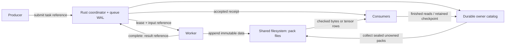

# 设计与协议规格

[English](DESIGN.md)

本文是 straw 的设计与 spec 入口：人审查规则与环境前提，agent 核对文档 → TLA+ → 实际实现。规则 ID 在三部分之间保持稳定；字节布局见[格式](FORMAT_zh.md)，API 与应用集成见[使用指南](USAGE_zh.md)。

## 架构与取舍

AI 流水线会共享 token、分数、路由、张量和中间状态。straw 把三个问题分开处理：不可变 pack 保存字节；队列 WAL 记录任务与接收结果；共享 catalog 记录谁还需要数据。



协调器只处理元数据，worker 直接向挂载的文件系统写载荷。稳定 receipt 让响应丢失后的同一请求重放原结果；任务执行和应用外部副作用仍可能重复。Worker 部署、RPC、模型计算与样本语义由应用负责。

引用用路径、偏移和长度定位不可变 extent；manifest 也是 pack 内的记录。Chunk checksum 支持按行读取。COW 发布被修改张量的新版本，未变化的张量复用引用；目前没有页级 COW、存活记录搬迁或 pack 整理。

Rust 负责 framing、校验、fsync、WAL、状态转换及所有权；Python 提供类型化 API、NumPy/PyTorch 转换和编排。核心调用释放 GIL，但输入缓冲区会复制到 Rust 内存，不承诺零复制写入。Python 不维护第二套 WAL／队列状态机；测试保留独立模型和 wire oracle。

straw 面向有边界的任务与显式保留策略。完整 WAL／任务历史重放后仍留在内存，GC 不限制日志增长，也不猜测遗留 writer 已经死亡。小型同步事务可能受 fsync 延迟限制，吞吐需要按实际负载[测量](BENCHMARKS_zh.md)。

<a id="environment"></a>

## 术语、环境与调用者义务

统一术语：**accepted／已接受**表示队列 WAL 含已同步的完整事务；**applied／已应用**表示内存业务状态已更新或重建；**protected／受保护**表示持久 owner 保留完整传递性 pack 闭包；**reclaimed／已回收**表示 unlink 和全部必要目录屏障早于持久回执。错误返回不等于没有产生效果。

这些前提不是测试成功推导出的保证。模型的有限搜索范围、算法重试预算和实测分位数要分开解释。

| 外部条件 | straw 自己必须完成的工作 |
|---|---|
| 文件同步成功持久化此前字节；目录同步持久化相关名称变化。错误可能发生在效果之后。 | 对正确句柄／路径执行全部必要屏障，错误后保留不确定性。不能从 advisory stat 或此前失败的同步推断持久缺失。 |
| Catalog 全部参与方使用相同稳定锁 inode，命名空间绑定稳定。 | 持锁、重新打开、比较 device／inode 和 pool／run、恢复，在 recheck／mark／append 之间持续持锁；缓存绑定准确上下文。入口检测不能阻止对手替换正在持锁的 inode。 |
| 每队列只有一个由外部 fencing 保证的修改协调器。 | 保留准确请求内容／回执身份，新接受校验 attempt／epoch。Owner 字符串不是 fencing。数值时钟漂移及选主／分区恢复未建模。 |
| 数据和引用不可变，读取真实，哈希防碰撞且库行为正确。 | 读取并认证所需全部范围，校验 framing／length／envelope／index，枚举完整依赖图并验证缓存 key。下层原语成功不证明上层选对了字节。 |
| Writer gate 交接完成或取消旧远程在途 I/O；fence 持久且对后继持有者可见。 | 持有并检查准确 gate，登记操作，保留未决描述，认证恢复结果，按序 stage／reconcile／release／settle／seal／receipt。进程死亡或超时不足以满足条件。 |
| 应用如实报告 reader／rank 完成，选择已提交且匹配的 checkpoint；需要进展时最终释放 owner。 | 撤权后仍保留 reader，确认处理前 retain replay 输入，回退队列 WAL 前重新保留根。文件系统进展不能推导应用释放。 |
| 仅活性：I/O／锁返回、故障最终稳定、公平调度及调用者继续重试。读取另有配置的可见性前提。 | 保持重试可执行，区分无效／永久失败，保留待办及有限读预算。不由此承诺自动 GC、逐任务公平或墙钟 SLA。 |
| Payload provider 最终返回；编译器、分配器、serde、SHA 和 OS 符合其合同。 | 检查声明长度、算术和 callback 错误。普通确定性 helper 使用真实回归，不维护库证明包装。 |

机器可读的 [environment_contracts.json](../verification/environment_contracts.json) 登记同一组前提及消费者：`provided_by` 是提供者，`implementation_obligation` 是 straw 必须完成的工作，`unproved` 是证据边界。环境登记检查核对编号、文件和导入，不证明假设为真。实际挂载与故障范围按[部署指南](FILESYSTEM_zh.md)验证。

<a id="distributed"></a>

## 1. 分布式协议：提交、重试与恢复

<a id="c1"></a>

**C1 — 交接。** 不可变数据发布后先由 staging 保护。队列接受顺序：

```
在 catalog retain 完整目标根；同步 catalog
写队列 frame（header、payload、trailer）；同步队列 WAL
启动应用隔离；应用全部事件；确认应用成功
用唯一持久 handoff receipt 消费 staging
回复
```

Catalog 与队列日志独立。步骤之间崩溃可以多保留保护，不能让已接受且存活的引用失去保护。接受 frame 包含 handoff 身份。恢复必须在新提交、缓存回复和 GC 前重建并处理未完成交接；已记录的旧 handoff 不得消费后来重新 staging 的 publication。重放历史退休本身也必须先写入持久队列事务，之后才能裁剪 owner。

<a id="c2"></a>

**C2 — 身份与重试。** 稳定请求 ID 绑定内容和结果。先查询匹配的已记录回执，再考虑旧 payload 或 lease 校验；payload 可能已经回收。内容冲突必须报错。新请求必须校验当前 task／attempt／epoch 和过期状态。恢复撤销旧工作权限，但保留尚未退出的 reader 根。外部 fencing 必须排除并发协调器；`exclusive_owner` 字符串不执行 fencing。

`lease_seconds=None` 时，时间不会使 lease 过期：外部监督器必须探测故障，并在调用 `retire_worker` 前确认进程退出。Attempt／epoch 检查仍然必需，恢复时必须保留原有 lease 模式。

<a id="c4"></a>

**C4 — Checkpoint 回退。** 持久保存 model／optimizer／RNG checkpoint 及其匹配的 consumer 位置。该 checkpoint 之后已经处理的结果，需要在确认处理前有独立 replay owner。恢复 checkpoint 的位置，而非队列最新 cursor。回退 WAL 更新前先重新保留变为必需的 receipt／batch 根；保护缺失或数据损坏必须拒绝更新。替代版本持久化后才释放旧 checkpoint／replay owner。真实 checkpoint 提交和全部 rank 完成信号由应用提供。

<details>
<summary>模型与实现对应</summary>

| 规则 | TLA+ 动作／性质 | 有意保留的抽象差异 |
|---|---|---|
| C1 | `DurableHandoff`：QueueRetain、CatalogWrite/Sync/Reply、QueueWrite/Sync/Reply、Consume、Prune；AcceptedProtected、StageReleaseOrdered。`CrossLogComposition`：Accept/Consume/Restore；QueueCoverage、OldHandoffNoEffect | 前者分开部分写入和两次同步；后者使用持久完整事务，不能据此声称下层 write／sync／apply 原子。 |
| C2 | `Completion`：OnlyCurrentAdmission、ReplayAfterRecovery、NoConflictingReplay。`RequestReplay`：OneAcceptance、CachedReply。`CrossLogComposition`：CurrentLeaseOnly、CorrectRetry | 小身份域、布尔过期；未模拟数值时钟或选主。Epoch／attempt 变化后匹配回执仍有效。 |
| C4 | `TrainingResume`：HoldReplay/Acknowledge/Checkpoint/Restore；CheckpointMatches、ReplayDataAvailable、ResumeMatchesModel。`CrossLogComposition`：Retain/Restore、QueueCoverage | 标量训练位置代表 sparse／batch 进度；真实 checkpoint 文件发布和 optimizer 正确性属于应用。 |

| 规则 | 实际调用链 | 回归／反例入口 |
|---|---|---|
| C1–C2 | `rust/coordinator.rs`：open/commit/finish_consumption/retain_commit → `queue_commit::persist_and_apply`、`queue_handoff`、`request`、coordinator 接受检查 | `tests/test_durable_handoff.py`、`test_commit_consumption.py`、`test_request_replay.py`、`test_filesystem_queue.py`；TLC retain 前接受、提前回复、重复接受、旧 epoch／attempt、消费新 staging 负例 |
| C4 | `Coordinator::training_roots/commit`、`queue_commit::restore_event`、`queue_progress`、`queue_roots`、`Config::verify_queue_reactivation` | `tests/test_consumer_rewind.py`、`test_resume_workflow.py`、`test_filesystem_queue.py` 的 optimizer replay；TLC 混合 checkpoint、最新 cursor、遗漏 replay owner、未 retain 就恢复负例 |

</details>

<a id="wal"></a>

## 2. WAL 与数据 I/O

本部分给出上层协议依赖的日志恢复、不可变发布与认证读取规则。

<a id="c3"></a>

**C3 — WAL 上下文与恢复。** 追加要求日志可用且独占。Catalog 事务先取稳定锁、重新打开、核对相同 inode 和 pool／run、完成恢复同步，再调用业务逻辑。入口／出口 guard 拒绝不确定、嵌套或外来上下文。可能失败的写入或 callback 前启动隔离；错误或捕获的 unwind 保持隔离。下层 fsync 成功不能独自解除部分应用的隔离或授权缓存操作。

恢复认证 framing 和精确哈希范围，按序重放完整事务，拒绝完整损坏 frame，只截断不完整残尾，完成同步并定位到有效末尾。业务索引、回执和派生缓存必须从同一前缀重建后才能复用。不得丢失已确认前缀。完整的不确定 frame 可以存活；重试不得产生第二次接受。

独占 writer registry 可以在重新取得准确 gate、核对新打开日志的 inode 和长度后，复用已确认且完整应用的前缀及操作索引。不确定追加或应用会使缓存失效，必须重放。该优化不压缩历史，也不删除回执。

<a id="r1"></a>

**R1 — 准备与持久化。** 使用新且不复用的 pack 名称。数据 I/O 前登记为 open，写 manifest 前 retain 依赖准备 owner。写入前捕获旧追加边界；不完整清理不得截断已确认前缀。错误后保留未完成的准备／清理状态。同步数据及必要目录名称，持久化 staging 保护，之后才释放准备持有者。解决待清理状态后才能 seal。

同一 writer incarnation 内，完整同步成功的祖先链可以复用，但必须保持目录 inode 打开并核对当前名称仍指向它。初始化失败不能建立缓存。新文件名称和 payload 仍需各自屏障；GC 修复父目录不使用这个缓存。

<a id="r2"></a>

**R2 — 发布重试。** 未决输出绑定准确 API、请求和内容。可能结果不明的同步之前先保存描述。拒绝冲突操作；正确重试重复未知屏障、认证原字节之后才返回。关闭或轮换不能丢掉已完成但尚未返回的描述。Staging 只交给准确的完成 handoff；旧交接完成后可以开始新的 staging 生命周期。

<a id="r3"></a>

**R3 — 认证读取。** 调用者必须有 G1 保护。引用绑定 pool／run 和 namespace；index 缓存命中要求准确的不可变引用。检查 extent 边界及所选 frame 与 index 的一致性，认证 envelope 和请求 payload／checksum chunk，并在返回或分配 payload 前绑定 tensor dtype／shape／length。缓存 index 不得跳过 record／envelope／payload 校验。空 typed 区间仍需校验 layout。

会话使用最多八条 index、8 MiB 编码元数据预算的 LRU；一个超大活动 index 会淘汰其他条目。未命中时先认证再缓存；失败不能选中无关的旧 index。同一会话的调用串行，独立会话可以并行读取。

<a id="r4"></a>

**R4 — 可见性与失败。** 文件长度、header、footer／index、envelope 和 payload 可以独立变得可见。只在共享有限预算内重试可识别的可见性失败；每次关闭失败句柄并重新打开。名称 `NotFound` 有独立有限查找预算；无关 I/O 错误停止。持久损坏必须耗尽／拒绝，不能返回未认证字节。最终可见性是部署前提，不是测得的 p99，也不保证任何输入都会成功。哈希、解析器、分配器和文件系统实现不在有限协议模型检查范围内。

<details>
<summary>模型与实现对应</summary>

| 规则 | TLA+ 动作／性质 | 有意保留的抽象差异 |
|---|---|---|
| C3 | `WalRecovery`：Write/Fail/Scan/Truncate/RecoverSync、AcknowledgedSurvives、ReadyDurable。`CatalogTransaction`：BoundCaller、CacheMatchesPrefix、NoCachedAfterError；`CatalogReplay`：CoherentReady、已确认前缀复用与 dirty cache 拒绝。`CommitApplication`：Begin/Hook/Recover、AcceptedDataPresent | frame 段抽象字节；哈希／解析器和锁服务外置。实际 callback 和全部公开入口 guard 仍需实现审查。 |
| R1 | `PublicationPreparation`、`IncompletePublication`、`DirectoryDurability`、`ProvisionalHold`、`PublicationFinalization`：预留、回滚、目录屏障、staging、sealing | 唯一不可变名称及真实文件系统屏障；存活 writer 拥有回滚资格。 |
| R2 | `PendingPublication`：OneCompletedFile、WriterFenced、DurableVerifiedReturn。`PublicationHandoff`：NoForgottenUnreturnedFile、CompletedHandoff。`StagingConsumption`：回执／图恢复 | 失败响应可留下效果；不同 API／请求／内容不能消费或覆盖未决输出。 |
| R3 | `ReadAttempt`：Index/Frame/Envelope/Payload、NoUnverifiedReturn。`RangeRead`／`TypedRead`：认证区间及 layout。`NamespaceIdentity`：规范绑定 | wire／index／frame／envelope 错误分别建模；热缓存只授权准确的已认证 index，不授权 record 字节。 |
| R4 | `ReadAttempt`：CloseFailed/Retry、ReleasedBetweenAttempts、Terminates。`ReadLookup`：查找／extent 重试、HardErrorsStop | VisibleBy 是尝试次数而非毫秒。持续损坏和无关存储错误需负向结果；合法可见输入需成功结果。 |

| 规则 | 实际调用链 | 回归／反例入口 |
|---|---|---|
| C3 | `journal_owner::{open,append_with,recover_with}` → `journal_io` → `journal_state`、`wal_append/recovery/source/sink`、`file_adapter/primitives`；`catalog_runtime::Transaction` → `catalog_transaction::execute`、`catalog_log`；`Store::enter_writer` → `writer_gate::{Permit::registry,Registry::append}`；`queue_application::{arm,apply,confirm,restore,permitted}` | `tests/test_wal_recovery.py`、`test_task_recovery.py`；原生 gc／writer_gate 的身份替换、捕获 unwind、dirty cache；queue_application 的 callback／部分应用；逐字节残尾／XOR 与进程退出实验 |
| R1–R2 | `Store::finish/publish_attempt/close/prepare_directory`、`Config::finalize_publication` → `incomplete`、`pending`、`finalization`、`holding`；`gc::consume_once` → `staging_consumption` | `tests/test_publication_preparation.py`、`test_pending_publication.py`、`test_provisional_holds.py`、`test_commit_consumption.py`、`test_packed_store.py`；原生 stream callback 与目录缓存失败／身份回归 |
| R3–R4 | `rust/store.rs` 的 Reader／read session → `record_index::Cache/Attempt`、`reference_node`、`extent_retry::run`、`bounds::frame_position/authenticated_span`、实际 read／hash | `tests/test_extent_visibility.py`、`test_read_session.py`、`test_extent_bounds.py`、`test_tensor_preflight.py`、`test_tensor_granularity.py`；TLC 冷／热缓存、区域可见性、index／frame／envelope／cache 错误、payload 损坏、重试停滞 |

</details>

<a id="gc"></a>

## 3. 所有权与 GC

<a id="g1"></a>

**G1 — 根。** 保留每个存活任务、未退出 reader、未处理结果、未完成 batch、checkpoint、staging、准备 owner 和其他队列的完整图。Lease 超时、取消或 epoch 撤销不等于读完。只有明确完成信号或外部确认 worker 退出才能释放 reader 根。序列化引用字节本身不是 owner。

<a id="g2"></a>

**G2 — Reactivation 与缓存。** 只在同一 pool／run／namespace 和引用身份内缓存完整不可变闭包。持 catalog 锁获取候选，锁外认证缺失根，随后重新获取新鲜持锁 catalog，在追加任何 owner 前重查所有 source owner 和 tombstone。认证结果不是受保护快照。复用已有 owner 必须确认它覆盖请求根：保留的队列名称绑定引用摘要，可修改的公共 owner 名称必须核对其实际闭包。底层兼容 API 也允许在已持锁时完成认证。

<a id="g3"></a>

**G3 — 回收。** C1 的历史退休持久化后，只裁剪当前队列的旧 owner。公开 store／coordinator 回收路径按序执行：

```
持 catalog 锁发现 sealed 且无主的 pack；追加永久 tombstone 并同步
保存准确 pending 目标集合和 catalog 身份；释放文件锁与 mutex
unlink 本轮全部目标（包括 advisory stat 声称不存在的目标）
同步全部受影响父目录；必要时修复并同步缺失祖先名称
重新持锁恢复同一 catalog；只为本轮已完成且仍 pending 的目标记回执
同步回执后返回
```

Unlink `NotFound` 是幂等缺失，不是持久删除。已经缺失的 pending 文件仍需父目录屏障。其他错误上报并保留待办。回执停止重复删除／计数，但保留永久 tombstone；迟到 retain 不得复活路径。存活 extent 保护整个 pack。离线清理要求客户端停止、无共享 catalog／queue 标记、完整接受根及路径绑定追踪，以及新的未变化检查结果。

多个 collector 可以重叠执行：unlink 幂等，各自完成自己目标的父目录屏障。回执不能包含本轮快照之后加入的目标。失败后持久 pending 留给后续调用处理。底层 `LockedCatalog::collect` 兼容 API 仍持有外层锁。Python coordinator 的 GC 调用彼此串行，但在根退休和 tombstone 准备完成后释放两层队列锁；物理删除期间其他队列调用可以继续。回执阶段重新获取新鲜 catalog，只使用已捕获的计划。

<a id="g4"></a>

**G4 — Writer 退休与进展。** 每次 writer 修改持有准确 incarnation 的 gate 并检查持久 fence。产生效果前先登记操作身份、准备 owner 和依赖。退休获取相同 gate，持久化 fence，排空旧 I/O，对账已登记操作，然后释放准备 owner、记录结算、seal 预留文件、持久化退休回执。Recover 在释放前认证完整结果并 staging；abandon 不声称结果可读。重试可能重复任意已生效步骤。PID、年龄和超时都不能证明退休安全。

显式 `discard_staging=True` 在上述退休完成后，以独立 catalog 事务释放该 writer 已登记结果的准确 staging owner，不递归释放依赖 writer 的 staging。调用者必须先停止相关 reader，并以独立持久 owner 保留仍需使用的结果；此时返回引用不受 staging 保护。错误后的重试仍须完成退休后再释放，其他 owner 保持不变。`WriterRetirement` 模型覆盖到退休回执；后续显式放弃沿用 owner 释放规则，由实际回归检查接口组合。

Owner 持续存在或错误反复发生时，安全性仍须成立。最终回收只针对 sealed 且**永久无主**的对象，还要求持续调用 GC、锁／I/O 返回、故障最终稳定及公平调度。这不提供延迟上限，也不意味着存在自动后台回收器。

<details>
<summary>模型与实现对应</summary>

| 规则 | TLA+ 动作／性质 | 有意保留的抽象差异 |
|---|---|---|
| G1 | `Ownership`：ReaderProtection、CheckpointProtection、NoDanglingReferences。`DurableHandoff`：ReadersProtected；独立 reader／checkpoint／peer 场景 | 完整应用根由 straw 调用者建立；持有引用不等于 owner。永久持有者场景不假定释放。 |
| G2 | `ReactivationRace`：Prepare/Verify/Recheck/Append；AuthenticatedRoot、CompleteAuthorizedClosure、NoDanglingRestore。`DependencyTraversal`：CompleteClosure | 完整认证图是下层读取边界；缓存上下文不匹配必须重新认证，owner／root 不匹配必须在任何 owner 追加前拒绝。 |
| G3 | `GCConcurrentDeletion`：PlanFenced、ReceiptScoped、OwnedPresent；`GCDiscovery`、`GCBatchDeletion`、`GCParentRepair`、`GCReceipt`：发现、mark、unlink、共享父目录／祖先屏障、回执；DurableCompletion、ReceiptIsSafe、ReceiptKeepsFence | 多父目录和缺失父目录义务独立，stat 仅供参考。`OfflineRoots`／`OfflineAliases` 增加停机及路径绑定根，不授权并发清理。并发模型检查安全性；重试／进展义务仍由下层 GC 模型检查。 |
| G4 | `WriterRetirement`：register/hold/submit/finish、fence/drain/authenticate/recover/release/settle/seal/receipt；AuthenticatedRecovery、ReceiptSound、RequiredProgress。`WriterLifetime`：在途工作。`DurableHandoff`：EventuallyReclaimed | Gate 交接必须完成／取消旧远程 I/O；release 与 registry settlement 是独立崩溃点。活性需要稳定、公平调度和真实调用者重试。 |

| 规则 | 实际调用链 | 回归／反例入口 |
|---|---|---|
| G1–G2 | `queue_roots::collect`、`queue_reader`、`queue_gc::prepare/require`；`gc::VerifiedReactivation::verify`、`check_reactivation_owners`、`retain_verified_inner`、`closure_inner` → `closure::collect`、`reference_node`、`record_index` | `tests/test_online_gc.py`、`test_queue_gc_roots.py`、`test_path_identity.py`；`tests/native.rs` 的 pool／run、source 丢失和 owner 替换竞态；TLC 旧快照、错误上下文／根、遗漏依赖 |
| G3 | Coordinator collection → `queue_retirement`、`queue_gc_prepare`、`gc_plan::{plan_collection,Plan::execute,complete_collection}` → `gc_mark`、`gc_batch`、`gc_io`、`directory_io`、`gc_receipt` | `tests/test_gc_concurrency.py`、 `test_gc_batch.py`、`test_gc_receipts.py`、`test_gc_missing_parent.py`、`test_offline_aliases.py`；原生缺失文件／失败屏障／共享父目录；TLC 提前回执、丢失 tombstone、遗漏父目录 |
| G4 | Store 修改 → `writer_gate_flow`、`writer_gate::Registry`；`Config::retire_writer` → `writer_retirement::execute`、`gc_writer::Retirement/Recovery`、`writer_registry::reconcile_registered`、`writer_ownership::authenticate_all` | `tests/test_writer_retirement.py`；原生 gc_writer 的损坏、recover／abandon、已登记 owner；TLC death-unlock、跳过 registry／认证、提前 release／receipt 及条件进展 |

</details>

<a id="review"></a>

## 如何核对规格与实现

每部分的对应表标明抽象差异，不是 refinement 证明。模型路径在 `verification/<area>/tla/`，Rust 路径在 `rust/`；按实际 `.cfg` 和 runner 配置确认性质被启用。人先审查以上规则；agent 再按 [straw-protocol-review skill](../.agents/skills/straw-protocol-review/SKILL.md)核对文档与 TLA+，随后从公开入口检查 TLA+ 与调用链的一致性。

保留的模型集中于持久化、跨日志、所有权、崩溃／重试和条件进展。TLC 正例必须通过，语义负例必须违反指定性质；工具／解析错误和超时不算检出。正常路径也必须可完成，避免一律拒绝造成假安全。普通确定性 Rust 依靠编译器、Clippy 和有意义的边界测试。

回归重点包括 WAL 前释放 staging、错误后复用部分状态、漏掉 reader／队列 checkpoint 根、目录同步前写回执，以及既有 owner 保护错误根。它们对应上表的真实调用点；公共 `checkpoint:*` owner 与队列 checkpoint 不能相互替代测试。按[贡献指南](../CONTRIBUTING_zh.md#checks)运行检查，报告当前输入和实际结果。

`check_mutations.py` 还对实际 Rust 代码注入选定故障，要求指定运行时回归失败；编译错误、缺失测试和超时均不算检出。

有限模型、具体执行回归与源码审查提供互补证据，不构成完整 Rust／Python／FFI 等价证明、无界定理或文件系统掉电认证。进程退出保留内核和存储服务；不能据此推断真实存储服务故障行为。变更规则时同步模型、调用者、环境登记和中英文正文；验证日志保存在 CI artifacts 或忽略目录中，不追加成规格正文。
